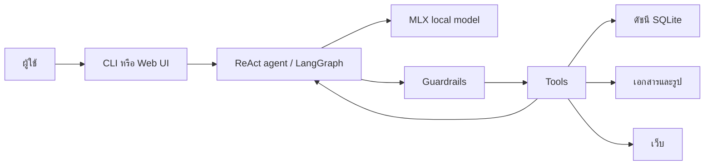

# ENDEAVOR AGENT LITE

## ผู้ช่วย AI ภาษาไทยที่ทำงานบน Mac ของคุณเอง

ENDEAVOR AGENT LITE ช่วยให้ Mac Apple Silicon เครื่องเล็ก รวมถึงรุ่นที่มี RAM 8 GB มี AI agent สำหรับงานกับไฟล์ เอกสาร รูปภาพ และข้อมูลปัจจุบันจากเว็บ โดยไม่ต้องส่งไฟล์ในเครื่องไปประมวลผลกับ LLM บนคลาวด์ และไม่มีค่า token รายเดือนสำหรับโมเดล

คุณพิมพ์คำสั่งภาษาไทยตามปกติ แล้ว agent ช่วยค้นหาเอกสารที่หาไม่เจอ อ่านและสรุป PDF/Word/Excel ตรวจรูปภาพ ค้นเว็บพร้อมลิงก์อ้างอิง หรือสร้างไฟล์ผลลัพธ์ในพื้นที่ทำงานที่ควบคุมไว้ได้

> **เหมาะเมื่อคุณต้องการความเป็นส่วนตัวและความคล่องตัว มากกว่าการใช้โมเดลขนาดใหญ่** — LITE ใช้โมเดลขนาดเล็กแบบ local จึงเหมาะกับงานประจำวันและคำสั่งที่ชัดเจน ไม่ได้ออกแบบมาแทนโมเดลใหญ่สำหรับงานวิเคราะห์หลายชั้นหรือวิจัยขนาดใหญ่

### คุณจะได้อะไร

- **ค้นหาไฟล์และเอกสารได้เร็วขึ้น** — สร้างดัชนีในเครื่อง แล้วค้นจากชื่อและเนื้อหาเอกสารด้วยภาษาไทย อังกฤษ หรือคำผสม
- **อ่านและสรุปเอกสารได้ในที่เดียว** — รองรับข้อความ, PDF, Word และ Excel; อ่านรูปด้วย OCR ของ macOS และใช้ vision model เมื่อจำเป็น
- **ถามข้อมูลปัจจุบันพร้อมแหล่งที่มา** — ค้นเว็บและแนบ URL ที่ใช้ประกอบคำตอบโดยอัตโนมัติ
- **ทำงานกับไฟล์อย่างมีขอบเขต** — สร้างไฟล์ได้เฉพาะใน `workspect/`; การอ่านและคำสั่ง shell มีชั้นป้องกันข้อมูลอ่อนไหว
- **ใช้ได้ทั้งหน้าต่าง Terminal และเบราว์เซอร์** — เลือก CLI ที่เบา หรือ Web UI แบบ local ที่จัดการเปิด–ปิดโมเดลได้
- **ข้อมูลสำคัญอยู่บนเครื่องคุณ** — โมเดล, ดัชนี SQLite และ log ทำงาน/เก็บอยู่ใน Mac ของคุณ; การเชื่อมต่อออกอินเทอร์เน็ตเกิดขึ้นเมื่อสั่งค้นเว็บเท่านั้น

---

## ใช้แก้ปัญหาอะไรได้บ้าง

| เมื่อคุณเจอปัญหานี้ | LITE ช่วยอย่างไร |
|---|---|
| “จำไม่ได้ว่าไฟล์อยู่ที่ไหน” | ค้นจากชื่อไฟล์และเนื้อหาในดัชนี SQLite FTS5 แล้วคืน path กับ snippet ที่เกี่ยวข้อง |
| “มีเอกสารหลายหน้า แต่อยากรู้ใจความก่อน” | อ่าน PDF, Word, Excel หรือ text แล้วสรุปเป็นภาษาไทย โดยจำกัดข้อมูลต่อรอบเพื่อให้เครื่องเล็กยังทำงานไหว |
| “ในรูป/สกรีนช็อตมีอะไรบ้าง” | ใช้ Apple Vision OCR อ่านข้อความ รวมถึงจัดเตรียมภาพให้ vision model วิเคราะห์เมื่อจำเป็น |
| “ต้องหาข้อมูลล่าสุดและตรวจที่มา” | ค้นเว็บ ดึงผลลัพธ์ที่ใช้ได้ และแนบแหล่งอ้างอิงท้ายคำตอบ |
| “อยากให้ช่วยทำไฟล์ แต่ไม่อยากเสี่ยงเขียนทับเครื่อง” | สร้างหรือเขียนทับไฟล์ได้เฉพาะใต้ `workspect/` ซึ่งเป็น workspace ที่กำหนดไว้ |

ตัวอย่างคำสั่ง:

```text
หาไฟล์ที่เกี่ยวกับ authentication ในโปรเจกต์นี้ให้หน่อย
อ่านไฟล์ report.pdf แล้วสรุปประเด็นสำคัญเป็น bullet
ในรูป screenshot.png มีข้อความหรือรหัสผิดพลาดอะไรบ้าง
ช่วยค้นหาว่า Python รุ่นล่าสุดมีอะไรใหม่ พร้อมแนบลิงก์
สร้างไฟล์สรุป.md ใน workspect จากข้อมูลนี้
```

## เหมาะกับใคร และควรคาดหวังอะไร

เหมาะกับผู้ใช้ macOS บน Apple Silicon ที่ต้องการผู้ช่วยภาษาไทยสำหรับงานส่วนตัวหรืองานเอกสารบนเครื่อง เช่น นักพัฒนา นักเรียน นักวิจัย หรือคนที่อยากค้นและสรุปข้อมูลโดยให้ไฟล์อยู่ในเครื่องเป็นหลัก

LITE เลือกใช้โมเดล `mlx-community/Qwen3.5-2B-OptiQ-4bit` เป็นค่าเริ่มต้นเพื่อให้ใช้งานบนเครื่อง RAM 8 GB ได้จริง โดยงานทั่วไปตั้งเป้าใช้หน่วยความจำรวมราว 3–4 GB ขึ้นกับข้อมูลที่เปิดและสภาพแวดล้อมของเครื่อง ผลลัพธ์จากโมเดลขนาดเล็กอาจแปรผันได้ จึงควรใช้คำสั่งที่ระบุเป้าหมายและขอบเขตให้ชัด และตรวจทานคำตอบสำคัญเสมอ

## เริ่มใช้งานแบบเร็ว

### 1. ติดตั้ง

```bash
# หลัง clone จาก URL ของ repository ที่เผยแพร่แล้ว
cd ENDEAVOR_AGENT_LITE
bash install_library/install.sh
```

ตัวติดตั้งจะพยายามสร้าง OCR helper จาก Swift source (เป็นฟีเจอร์เสริม ถ้าไม่มี Xcode Command Line Tools จะข้ามได้), สร้าง `.venv` ด้วย Python 3.11 และติดตั้ง dependencies ที่ lock พร้อม hash โดยยังไม่เริ่มโหลดโมเดล

### 2. เลือกวิธีเปิดใช้งาน

**CLI** — เปิด model server ใน Terminal หนึ่ง:

```bash
source .venv/bin/activate
python -m mlx_vlm.server \
  --model mlx-community/Qwen3.5-2B-OptiQ-4bit \
  --host 127.0.0.1 --port 8090 --api-key x \
  --prefill-step-size 512
```

แล้วเปิดอีก Terminal:

```bash
source .venv/bin/activate
python ui_cli.py
```

พิมพ์ `/index` ครั้งแรกเพื่อสร้างดัชนีไฟล์ หรือใช้ `/exit` และ `/quit` เพื่อออกจาก CLI

**Web UI** — เปิดด้วย:

```bash
source .venv/bin/activate
python web_ui.py
```

จากนั้นไปที่ [http://127.0.0.1:8766](http://127.0.0.1:8766) แล้วกดเปิด model server จากหน้าเว็บได้ ตัว Web UI เปิดรับเฉพาะเครื่องตัวเอง (`127.0.0.1`) เพื่อไม่เผย filesystem tools ให้เครื่องอื่นในเครือข่าย

## ความสามารถหลัก

| ความสามารถ | สิ่งที่ทำได้ |
|---|---|
| ค้นหาไฟล์ (`rag_search`) | ค้นชื่อและเนื้อหาเอกสารผ่าน SQLite FTS5 พร้อม path และ snippet |
| อ่านเอกสาร (`read_file`) | อ่าน text, code, PDF, Word และ Excel แบบ read-only |
| อ่านรูป (`read_image`) | OCR ด้วย Apple Vision; รองรับการวิเคราะห์ภาพด้วย vision model ภายใต้ขนาดและความปลอดภัยที่กำหนด |
| สร้างไฟล์ (`write_file`) | เขียนไฟล์เฉพาะใต้ `workspect/` และต้องยืนยันก่อนเขียนทับ |
| ค้นเว็บ (`web_search`) | ค้นข้อมูลปัจจุบันและคืน URL ของแหล่งข้อมูล |
| คำสั่งอ่านอย่างปลอดภัย (`bash`) | ใช้คำสั่งที่อยู่ใน allow-list สำหรับค้น/อ่านข้อมูลเท่านั้น พร้อม timeout และการตรวจ path |

### ดัชนีไฟล์ทำงานอย่างไร

เมื่อสั่ง `/index` ระบบจะสแกน `Desktop`, `Documents` และ `Downloads` เป็นค่าเริ่มต้น แล้วเก็บข้อมูลที่จำเป็นลง SQLite บนเครื่อง เพื่อค้นหาภายหลังได้รวดเร็วขึ้น คุณจำกัดขอบเขตให้เหลือเฉพาะโฟลเดอร์งานได้ เช่น:

```bash
export LITE_INDEX_ROOTS="$HOME/Documents/my-project,$HOME/Desktop/reports"
python ui_cli.py
```

ดัชนีออกแบบมาเพื่อค้นหาเอกสาร ไม่ใช่เพื่อเก็บทุกไฟล์ในเครื่อง และจะข้าม path หรือเนื้อหาที่เข้าข่ายข้อมูลอ่อนไหวตามนโยบายความปลอดภัยของระบบ

## ความเป็นส่วนตัวและความปลอดภัย

LITE ให้ความสำคัญกับการใช้งานไฟล์บนเครื่อง แต่ไม่ได้หมายความว่าระบบมีสิทธิ์เข้าถึงทุกอย่างโดยไม่มีข้อจำกัด

- Local model server และ Web UI bind กับ `127.0.0.1` เท่านั้น
- ไม่ใช้ LLM API บนคลาวด์: โมเดลทำงานผ่าน MLX บน Mac ของคุณ
- ดัชนี, cache และ log อยู่ใต้ `workspect/.lite_state/` โดยค่าเริ่มต้น
- การเขียนไฟล์ถูกจำกัดที่ `workspect/` และป้องกัน path traversal กับ symlink escape
- path และเนื้อหาที่เข้าลักษณะ credential, token, private key หรือ session ถูกบล็อก/ไม่ส่งกลับเข้าบทสนทนา
- `bash` ใช้ได้เฉพาะงานอ่านและค้นหาที่ผ่าน allow-list ไม่ใช่ shell สำหรับรันคำสั่งอิสระ
- การค้นเว็บส่งออกเฉพาะคำค้นและ URL ที่จำเป็นไปยังบริการค้นหา; ไฟล์ในเครื่องไม่ถูกส่งให้ hosted LLM

ยังควรตรวจคำตอบและแหล่งที่มาก่อนใช้ตัดสินใจเรื่องสำคัญ และไม่ควรใส่ข้อมูลลับลงในคำสั่งหรือไฟล์ workspace โดยไม่จำเป็น

## ความต้องการของระบบ

- macOS บน Apple Silicon
- Python 3.11
- หน่วยความจำเพียงพอสำหรับโมเดลที่เลือก (ค่าเริ่มต้นคือโมเดล quantized ขนาด 2B)
- อินเทอร์เน็ตเฉพาะเมื่อใช้ `web_search`

โปรเจกต์ออกแบบและทดสอบกับ `mlx-community/Qwen3.5-2B-OptiQ-4bit` หากเปลี่ยนโมเดล ควรทดสอบการเรียก tools และความปลอดภัยอีกครั้ง เพราะโมเดลแต่ละตัวอาจทำตาม structured tool calling ได้ไม่เท่ากัน

โมเดลนี้ถูกดาวน์โหลดแยกต่างหากเมื่อเปิด server ครั้งแรก ไม่ได้ถูกเก็บใน repository และมี license Apache-2.0 ตาม [model card](https://huggingface.co/mlx-community/Qwen3.5-2B-OptiQ-4bit) ของผู้เผยแพร่โมเดล

## การตั้งค่า

ค่าหลักเปลี่ยนผ่าน environment variables ได้โดยไม่ต้องแก้ source code:

| ตัวแปร | ค่าเริ่มต้น | ความหมาย |
|---|---|---|
| `LITE_MODEL` | `mlx-community/Qwen3.5-2B-OptiQ-4bit` | model ID สำหรับ MLX server |
| `LITE_MLX_BASE_URL` | `http://127.0.0.1:8090/v1` | URL ของ MLX server ในเครื่อง |
| `LITE_INDEX_ROOTS` | Desktop, Documents, Downloads | โฟลเดอร์ที่ให้ `/index` สแกน |
| `LITE_DATA_DIR` | `workspect/.lite_state` | ที่เก็บ SQLite index, cache และ logs; ต้องอยู่ใต้ `workspect/` |
| `LITE_MAX_TOOL_STEPS` | `6` | จำนวนรอบเรียก tool สูงสุดต่อคำถาม |
| `LITE_UI_PORT` | `8766` | port ของ Web UI |

## โครงสร้างการทำงานโดยย่อ



Agent จะเลือกตอบโดยตรงหรือเรียก tool ตามงานที่ถาม Guardrails จำกัดจำนวนรอบ ป้องกันการเรียกซ้ำ จำกัดขนาดผลลัพธ์ และตรวจทั้ง path กับข้อมูลที่อาจเป็นความลับ ก่อนสรุปคำตอบกลับเป็นภาษาไทย

## การทดสอบ

รัน regression suite แบบ deterministic:

```bash
python -m pytest test_suite -q
```

บางชุดเป็น integration หรือ live-model test ซึ่งต้องเปิด MLX server และมีเงื่อนไขตามที่ระบุไว้ในไฟล์ test นั้น

สำหรับการพัฒนา ใช้ `requirements-dev.txt`; dependency ทั้งหมดถูก resolve ใน `uv.lock` และมี hash ใน requirements files เพื่อให้ติดตั้ง release เดิมซ้ำได้

## การรายงานช่องโหว่และการร่วมพัฒนา

โปรดอ่าน [SECURITY.md](SECURITY.md) เพื่อรายงานช่องโหว่เป็นการส่วนตัว และ [CONTRIBUTING.md](CONTRIBUTING.md) สำหรับการตั้งค่า development กับกติกาการส่ง pull request

## License

MIT License + Commons Clause — see [LICENSE](LICENSE).

ใช้ส่วนตัวและเพื่อการเรียนรู้ได้อย่างอิสระ
ห้ามนำไปใช้เชิงพาณิชย์โดยไม่ได้รับอนุญาตจากผู้พัฒนา

## ผู้พัฒนา

Poomwat Jarussri

GitHub: [halochamp](https://github.com/halochamp)

Email: champoomwat@gmail.com
